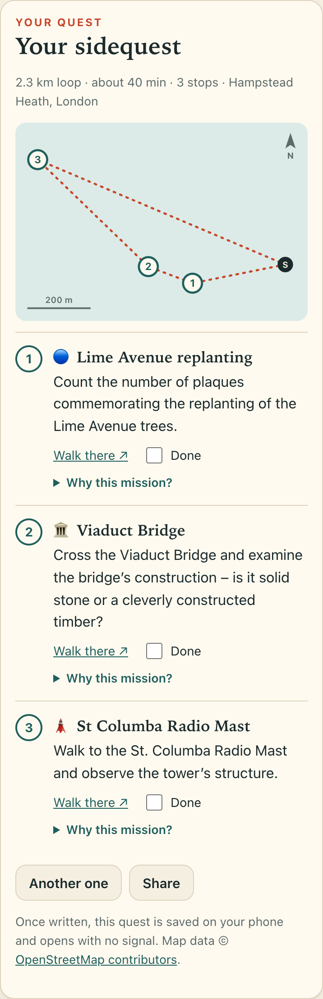
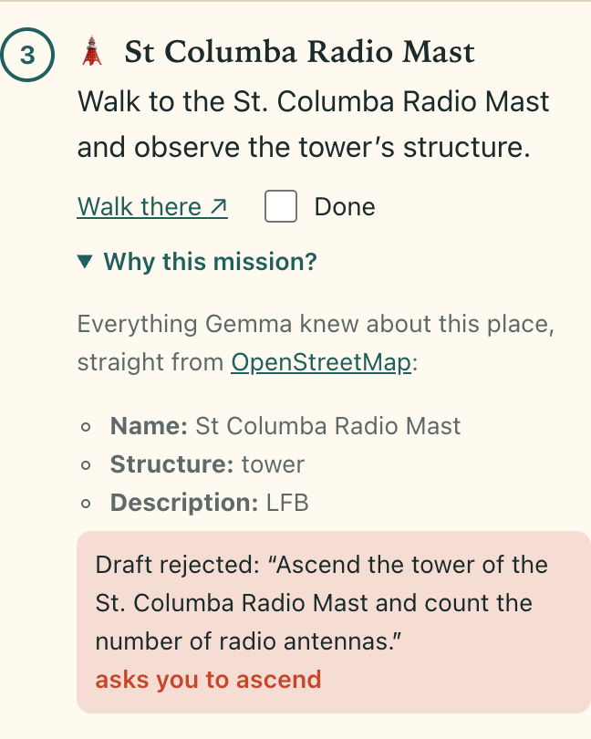

# WalkQuest 🧭

**Walking Quests From Your Map.** Formerly called Sidequest.

Turns the real map around you into a short walking quest.

Pick a start and a length (20 minutes, 40, an hour). WalkQuest reads OpenStreetMap around you, picks the most interesting real things within reach (a 500-year-old tomb, a blue plaque, the 1894 Liberty Tree, a whispering bench), routes the shortest loop through them that fits your time, and then **Gemma, running in your browser**, writes you one small thing to do at each stop.

Prove each stop with a photo, checked on the phone. Or run the quest as a team event, with a join code, a live leaderboard and a dashboard for the organizer.

**Live:** https://vanshajpoonia.github.io/sidequest/

> **Stop 2 · 🏛️ Viaduct Bridge.** Cross the Viaduct Bridge and examine the bridge’s construction – is it solid stone or a cleverly constructed timber?

 

## The model writes. The code navigates.

Given only a place's name, a 1B model fills the gaps with confident inventions (the table below counts them). So Gemma is never asked where to go: choosing stops and adding up distances is arithmetic, and arithmetic belongs in code.

```
OpenStreetMap (Overpass) ──► features ──► planner ──► stops + loop ──► Gemma writes one mission per stop
                              src/plan.js  src/plan.js                    │
                                                                          ▼
                                                     checker (src/mission.js) ──✗──► "It mentions 1540, which is not
                                                          │ ✓                         in the facts. Write it again."
                                                          ▼                                (up to 3 tries, then a template)
                                                       quest card, saved offline
```

- **Stops** come from OSM tags only, scored in code (named? has an inscription? a Wikipedia article? a date?), with at most one of each kind where possible.
- **The route** is the exact shortest start → stops → start loop (brute force over ≤ 4 stops), walked at 75 m/min with a 1.3× detour factor and 3 minutes per stop. If it does not fit your time, it is not offered.
- **Gemma sees nothing but the stop's OSM tags**, as a bullet list, plus four worked examples as real conversation turns.
- **The checker** rejects any mission that mentions a year or a proper noun not present in those tags, asks for a date the map does not have ("determine the original construction date" is a 1B model's favourite filler), suggests anything unsafe (climbing, wading, picking, feeding…), describes a scene instead of giving an instruction, or runs past 35 words. Rejected drafts go back to Gemma with the reason. After three tries a plain template is used: a boring mission beats an invented one.
- **"Why this mission?"** under every stop shows exactly what Gemma was given, links to the OSM object, and lists any drafts that were rejected and why.

## Measured

`npm test` runs Gemma 3 1B (q4, the same weights the browser loads) on the 24 highest-scoring stops around the four preset parks, in four configurations. Greedy decoding, so the table is reproducible.

| Prompt | Invented a name or date | Asked for a date the map lacks | Not a mission, or wrong walker | Clean |
|---|---|---|---|---|
| The place's name only (rules + examples) | 15 | 0 | 2 | 8 / 24 |
| OSM tags + rules, no examples | 0 | 0 | 12 | 12 / 24 |
| OSM tags + rules + 4 examples as chat turns | 4 | 1 | 3 | 16 / 24 |
| + checker, retry with feedback, template **(shipped)** | **0** | **0** | **0** | **24 / 24** |

Shipped: 16 missions pass on the first try, 5 after a retry with feedback, 3 fall back to a template. No configuration produced anything unsafe or over-long.

What the table teaches:

- **Given only a name, a 1B model fills the gaps.** "Search the Lion statue in Golden Gate Park for a discarded leash."
- **Rules in prose are not enough.** With no examples it often echoes the input ("Athpula Bridge", or just "Place:").
- **Examples as real chat turns fix the shape, and leak content.** A made-up "Red Tomb" from one example turned up at Karl Marx's grave in London.
- **The checker is what makes it shippable**, and it needed checking too: it first matched words as substrings, so "Red" passed because the inscription says "buried"; and the full stop in "St." read as the end of a sentence. Both fixed, both regression tests.

What it cannot catch: invented *ordinary* objects ("the most detailed carving of the lion's head" at a temple with no lions in its tags) and odd phrasing. That is why every stop has a "Why this mission?" panel.

## Prove each stop with a photo

Tap **📷 Prove it** at a stop and take a photo. A vision model on the phone checks it before anything else happens. It is the [TouchGrass judge](https://github.com/VanshajPoonia/proof-of-grass/tree/main/judge), CLIP ViT-B/32 in the browser, an 89 MB download once. It asks three things:

- **Is it outdoors?** Photos of rooms, desks and food are turned away.
- **Is it a photo of a screen?** A picture of the stop on someone's phone is turned away, most of the time.
- **Is it the kind of place the stop is?** A memorial can be a statue, a stone or a plaque, so each kind of stop accepts a few classes (`src/proof.js`). Viewpoints accept any outdoor photo.

`npm test` measures it on photos from Wikimedia Commons, credited in `tests/proof-fixtures.json`: 83 photos of real stops in the four preset parks, and 87 photos that should never count (rooms, desks, food, and real photos of screens).

| | Shipped |
|---|---|
| Stop photos that pass at a stop of their kind | 75 / 83 |
| Indoor and screen photos that pass at any stop | 0 / 87 |
| Stop photos pasted onto a screen that still pass | 68 / 996 |
| Stop photos that would also pass at a different kind of stop | 300 / 1086 |

Without the screen check, 187 of the 996 stop photos on a screen passed. A looser rule, top 3 at 10%, got one more stop photo right and let 45 more pass at the wrong kind of stop, so the judge's own thresholds ship. Of the 8 misses, 3 are benches the judge read as a picnic area or a garden, and 2 are wide lake views it read as a view. One is a photo inside a greenhouse filed under a garden, and turning that away is right. The wrong-kind row is high on purpose: kinds overlap, so a statue counts at a memorial, an artwork and a landmark. It stops a photo of a bench from proving a tomb, not a statue from proving a memorial.

These are from a clean run on 21 November. A clean run the day before gave 66, 188 and 303 in the same rows, with the same right-kind and leak numbers. The code, model and library versions were the same, and re-embedding a photo is repeatable to the bit within a run. So the likeliest cause is the photos fetched from Wikimedia differing between days, but that is not confirmed. Treat these rows as plus or minus 3.

The judge is copied into `vendor/touchgrass-judge/` from proof-of-grass. A copy is more reliable than loading it from the other app's Pages URL. Quests are walked with no signal, so the judge has to be cached with this app, and a deploy of the bingo app should never break a walk in progress. `npm run sync-judge` copies a new version and records the commit in `SOURCE.json`. `tests/vendor.mjs` fails if the copy is edited here.

## Team events

For a college fest or a team offsite. One person writes a quest and presses **Run it as a team event** under it. They get a six-character code and a dashboard. Teams join on `event.html` with the code and a team name, walk the same quest, and prove each stop with a photo. Only the organizer's device downloads Gemma. Teams need only the 89 MB photo judge.

- **Scoring** (`src/team/score.js`): 100 a stop, 25 for the first team to prove it, 50 for proving every stop. Level on points, the team whose last proof came first is ahead. Proofs before the start, after the time limit or after the organizer ends the event do not count.
- **Codes** (`src/team/code.js`): no 0, O, 1, I or L. The last character is a check, so every single wrong character and every swap of two neighbours is caught on the phone. `tests/codes.mjs` tries all of them on random codes.
- **The organizer** starts and ends the clock, sees every team's progress and proof photos, and can strike a proof that looks wrong. The photo check runs on each team's phone, so a team that edits the page could skip it. The organizer seeing every photo is the backstop.
- **A QR code** for the join link sits under the big code on the organizer page. The encoder is 264 lines with no library (`src/qr.js`). `tests/qr.mjs` checks it against the spec's examples, and `node scripts/qr-roundtrip.mjs` reads 47 symbols back with macOS CoreImage, every version from 1 to 10 at every error correction level plus real join links. All 47 come back exactly.
- **Distance as a second signal.** When a team proves a stop, the phone reads its location once and sends only how far it was from the stop (`src/locate.js`). The organizer sees it under each photo, in red past 150 m. A refused, missing or slow location sends no distance and the proof still counts.
- **The backend** sits behind a small interface (`src/team/backend.js`), and one rules engine (`src/team/local.js`) runs everywhere. By default events live in the browser and tabs hear each other over a BroadcastChannel, so a whole event runs on one device. For phones to see each other there is a hosted backend in `worker/`: a Cloudflare Worker with one Durable Object per event. The object runs the same rules engine over its own SQLite table, owns the clock and the keys, and pushes every change to every phone over a WebSocket. It refuses browsers from other sites, caps requests at 80 KB and clears events after 30 days.

`tests/backend-contract.mjs` is the list of checks a backend has to pass. `npm test` runs it against the local adapter. `npm run test:cloud` starts the Worker under `wrangler dev`, locally and with no account, and runs the same 17 checks through `src/team/cloud.js`, plus five server ones. One of those has team A prove a stop and checks that it reaches team B and the organizer.

### The hosted backend

The live site uses the Worker at https://events.vanshajpoonia.com, set in `BACKEND_URL` in `src/team/index.js`. It is served only from that domain, with the workers.dev address turned off (`worker/wrangler.toml`). To ship a change to it, run `npx wrangler@4.158.0 deploy` in `worker/`. Deploying needs a Wrangler login with the Workers and zone read permissions. Set `BACKEND_URL` to `''` to go back to one-device events.

## Privacy and offline

- **No AI service.** Gemma 3 1B instruction-tuned ([onnx-community/gemma-3-1b-it-ONNX](https://huggingface.co/onnx-community/gemma-3-1b-it-ONNX), q4) runs in the tab via [transformers.js](https://github.com/huggingface/transformers.js), WebGPU where available, WASM otherwise. ~860 MB, downloaded once and cached.
- **Your exact location never leaves the device.** "Start where I am" snaps the position to a ~500 m grid before querying Overpass, pads the radius to cover the snap, and filters by true distance locally. In a team event, a proof carries only how many metres it was taken from the stop.
- **Quests work with no signal.** A written quest is saved on the phone; the map is an SVG sketch drawn from coordinates, no tiles. A service worker serves the app shell offline. Write the quest at home on wifi, walk it anywhere.
- **Four preset parks** (Lodhi Garden, Golden Gate Park, Hampstead Heath, Central Park) are frozen OSM snapshots in `data/places/`, so the demo works without sharing a location and the tests have fixed fixtures.

## Run it

```bash
npm start           # static server on :8000, no build step
npm install         # only for the tests
npm test            # planner, codes, scoring, backend, vendor, proof-rule, QR and location checks, then the photo proof and Gemma evaluations
npm run sync-judge  # copy the TouchGrass judge again from proof-of-grass
npm run build-proof # after editing PLACES in src/proof.js
npm run test:cloud  # the hosted backend under wrangler dev (fetches wrangler@4.158.0 through npx)
node scripts/qr-roundtrip.mjs  # QR codes read back by macOS CoreImage
npm run freeze      # re-snapshot the preset parks from Overpass
```

## Files

```
src/osm.js       Overpass query, grid snapping, mirror fallback
src/plan.js      OSM elements -> scored features -> shortest loop that fits; SVG sketch geometry
src/mission.js   prompts, the checker, the retry-with-feedback loop, templates
src/gemma.js     Gemma 3 1B in the browser
src/app.js       UI
src/map-svg.js   the sketch map, shared by both pages
src/proof.js     what counts as photo proof at each kind of stop (pure, tested)
src/photo.js     the photo judge in the browser, thumbnails, messages
src/team/        team events: code.js, score.js, backend.js (the contract), local.js (the rules engine),
                 cloud.js (the hosted adapter), index.js (which one, one config line)
src/qr.js        QR codes for the join link
src/locate.js    how far from the stop a proof was taken
worker/          the hosted backend: a Cloudflare Worker and Durable Object, wrangler.toml
src/event-app.js the team and organizer page (event.html)
vendor/touchgrass-judge/  the photo judge, copied from proof-of-grass (see SOURCE.json)
data/proof-classes.json   precomputed text side of the photo judge
data/places/     frozen OSM snapshots of the four presets (ODbL)
tests/           plan.mjs, codes.mjs, score.mjs, backend.mjs, vendor.mjs, proof-rules.mjs, qr.mjs, locate.mjs
                 (no model, milliseconds), proof.mjs and gemma.mjs (the evaluations), cloud.mjs (the Worker)
```

## Credits

Map data © [OpenStreetMap contributors](https://www.openstreetmap.org/copyright), available under the ODbL. Gemma is provided under the [Gemma Terms of Use](https://ai.google.dev/gemma/terms). ONNX conversion by onnx-community; runtime by transformers.js and ONNX Runtime Web. The photo judge is CLIP by OpenAI, ONNX conversion by Xenova. Test photos for photo proof are from Wikimedia Commons, and each one's author and licence is in `tests/proof-fixtures.json` and `vendor/touchgrass-judge/frames.json`.

Code: MIT licence.
