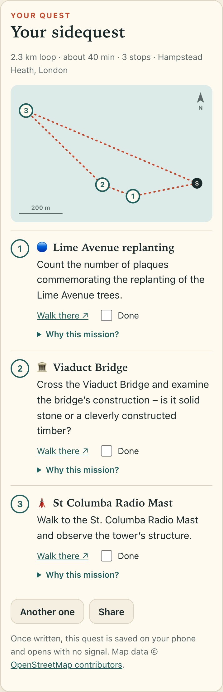
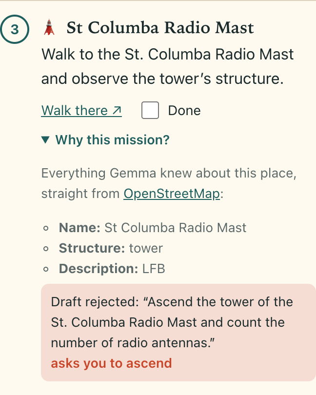

# Sidequest 🧭

Turns the real map around you into a short walking quest.

Pick a start and a length (20 minutes, 40, an hour). Sidequest reads OpenStreetMap around you, picks the most interesting real things within reach (a 500-year-old tomb, a blue plaque, the 1894 Liberty Tree, a whispering bench), routes the shortest loop through them that fits your time, and then **Gemma, running in your browser**, writes you one small thing to do at each stop.

**Live:** https://vanshajpoonia.github.io/sidequest/

> **Stop 2 · 🏛️ Viaduct Bridge.** Cross the Viaduct Bridge and examine the bridge’s construction – is it solid stone or a cleverly constructed timber?

 

## The model writes. The code navigates.

Given only a place's name, a 1B model fills the gaps with confident inventions (the table below counts them). So Gemma is never asked where to go: choosing stops and adding up distances is arithmetic, and arithmetic belongs in code.

```
OpenStreetMap (Overpass) ──► features ──► planner ──► stops + loop ──► Gemma writes one mission per stop
                              src/plan.js  src/plan.js                    │
                                                                          ▼
                                                     checker (src/mission.js) ──✗──► "It mentions 1540, which is not
                                                          │ ✓                         in the facts. Write it again."
                                                          ▼                                (up to 3 tries, then a template)
                                                       quest card, saved offline
```

- **Stops** come from OSM tags only, scored in code (named? has an inscription? a Wikipedia article? a date?), with at most one of each kind where possible.
- **The route** is the exact shortest start → stops → start loop (brute force over ≤ 4 stops), walked at 75 m/min with a 1.3× detour factor and 3 minutes per stop. If it does not fit your time, it is not offered.
- **Gemma sees nothing but the stop's OSM tags**, as a bullet list, plus four worked examples as real conversation turns.
- **The checker** rejects any mission that mentions a year or a proper noun not present in those tags, asks for a date the map does not have ("determine the original construction date" is a 1B model's favourite filler), suggests anything unsafe (climbing, wading, picking, feeding…), describes a scene instead of giving an instruction, or runs past 35 words. Rejected drafts go back to Gemma with the reason. After three tries a plain template is used: a boring mission beats an invented one.
- **"Why this mission?"** under every stop shows exactly what Gemma was given, links to the OSM object, and lists any drafts that were rejected and why.

## Measured

`npm test` runs Gemma 3 1B (q4, the same weights the browser loads) on the 24 highest-scoring stops around the four preset parks, in four configurations. Greedy decoding, so the table is reproducible.

| Prompt | Invented a name or date | Asked for a date the map lacks | Not a mission, or wrong walker | Clean |
|---|---|---|---|---|
| The place's name only (rules + examples) | 15 | 0 | 2 | 8 / 24 |
| OSM tags + rules, no examples | 0 | 0 | 12 | 12 / 24 |
| OSM tags + rules + 4 examples as chat turns | 4 | 1 | 3 | 16 / 24 |
| + checker, retry with feedback, template **(shipped)** | **0** | **0** | **0** | **24 / 24** |

Shipped: 16 missions pass on the first try, 5 after a retry with feedback, 3 fall back to a template. No configuration produced anything unsafe or over-long.

What the table teaches:

- **Given only a name, a 1B model fills the gaps.** "Search the Lion statue in Golden Gate Park for a discarded leash."
- **Rules in prose are not enough.** With no examples it often echoes the input ("Athpula Bridge", or just "Place:").
- **Examples as real chat turns fix the shape, and leak content.** A made-up "Red Tomb" from one example turned up at Karl Marx's grave in London.
- **The checker is what makes it shippable**, and it needed checking too: it first matched words as substrings, so "Red" passed because the inscription says "buried"; and the full stop in "St." read as the end of a sentence. Both fixed, both regression tests.

What it cannot catch: invented *ordinary* objects ("the most detailed carving of the lion's head" at a temple with no lions in its tags) and odd phrasing. That is why every stop has a "Why this mission?" panel.

## Privacy and offline

- **No AI service.** Gemma 3 1B instruction-tuned ([onnx-community/gemma-3-1b-it-ONNX](https://huggingface.co/onnx-community/gemma-3-1b-it-ONNX), q4) runs in the tab via [transformers.js](https://github.com/huggingface/transformers.js), WebGPU where available, WASM otherwise. ~860 MB, downloaded once and cached.
- **Your exact location never leaves the device.** "Start where I am" snaps the position to a ~500 m grid before querying Overpass, pads the radius to cover the snap, and filters by true distance locally.
- **Quests work with no signal.** A written quest is saved on the phone; the map is an SVG sketch drawn from coordinates, no tiles. A service worker serves the app shell offline. Write the quest at home on wifi, walk it anywhere.
- **Four preset parks** (Lodhi Garden, Golden Gate Park, Hampstead Heath, Central Park) are frozen OSM snapshots in `data/places/`, so the demo works without sharing a location and the tests have fixed fixtures.

## Run it

```bash
npm start           # static server on :8000, no build step
npm install         # only for the tests
npm test            # 31 planner/checker checks + the Gemma evaluation
npm run freeze      # re-snapshot the preset parks from Overpass
```

## Files

```
src/osm.js       Overpass query, grid snapping, mirror fallback
src/plan.js      OSM elements -> scored features -> shortest loop that fits; SVG sketch geometry
src/mission.js   prompts, the checker, the retry-with-feedback loop, templates
src/gemma.js     Gemma 3 1B in the browser
src/app.js       UI
data/places/     frozen OSM snapshots of the four presets (ODbL)
tests/           plan.mjs (no model, milliseconds), gemma.mjs (the evaluation)
```

## Credits

Map data © [OpenStreetMap contributors](https://www.openstreetmap.org/copyright), available under the ODbL. Gemma is provided under the [Gemma Terms of Use](https://ai.google.dev/gemma/terms). ONNX conversion by onnx-community; runtime by transformers.js and ONNX Runtime Web.

Code: MIT licence.
